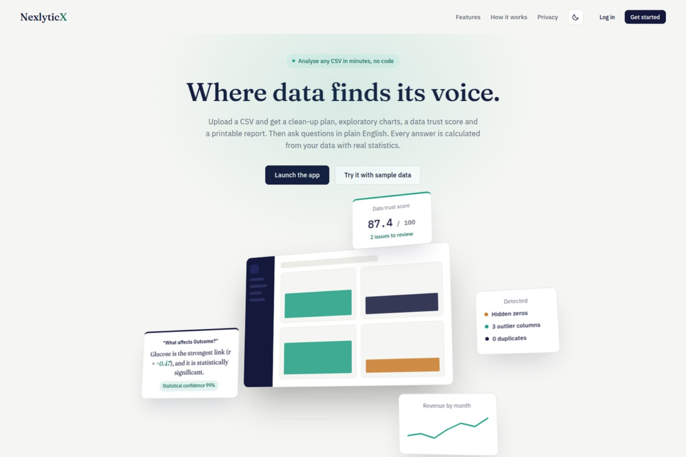
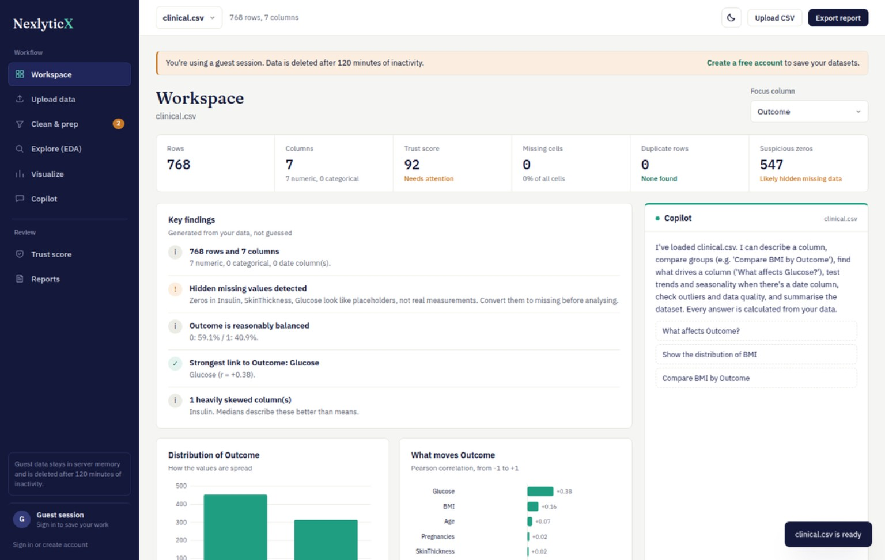
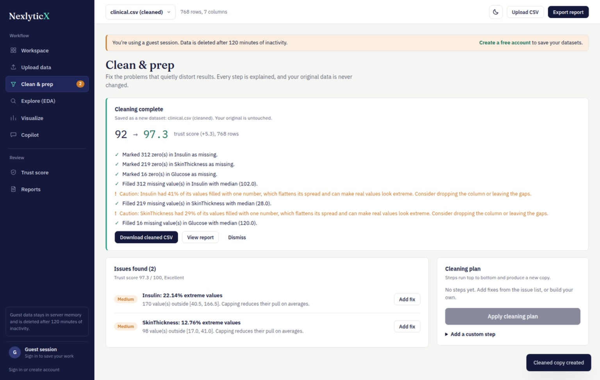
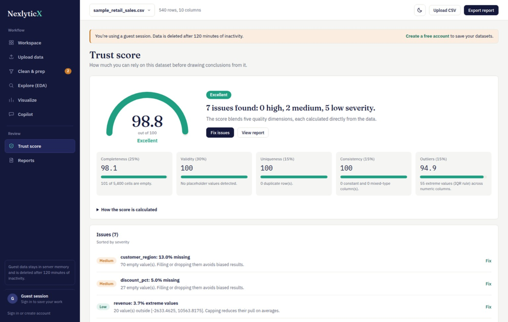
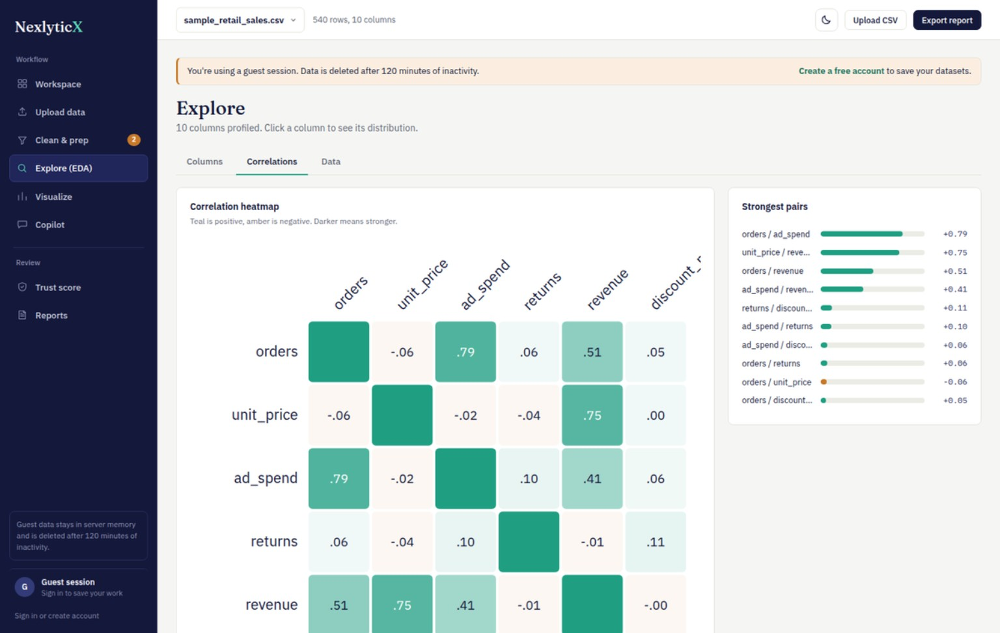
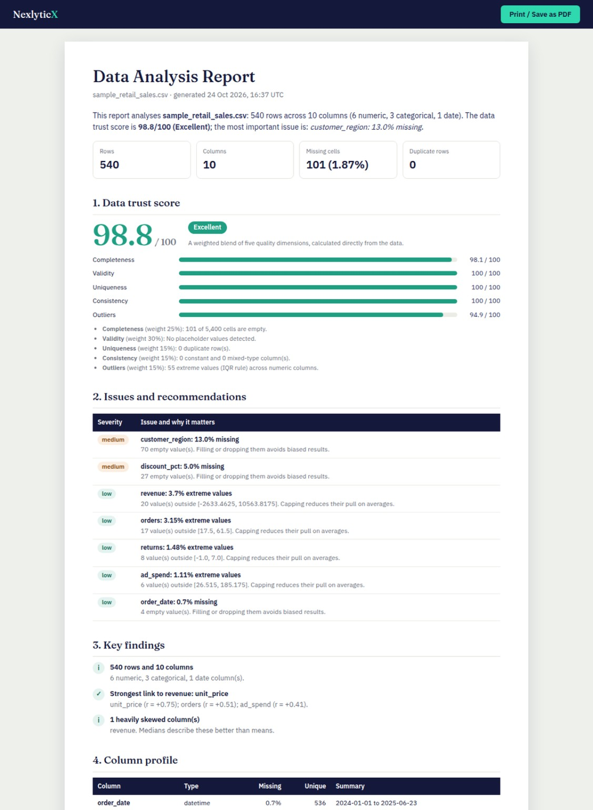
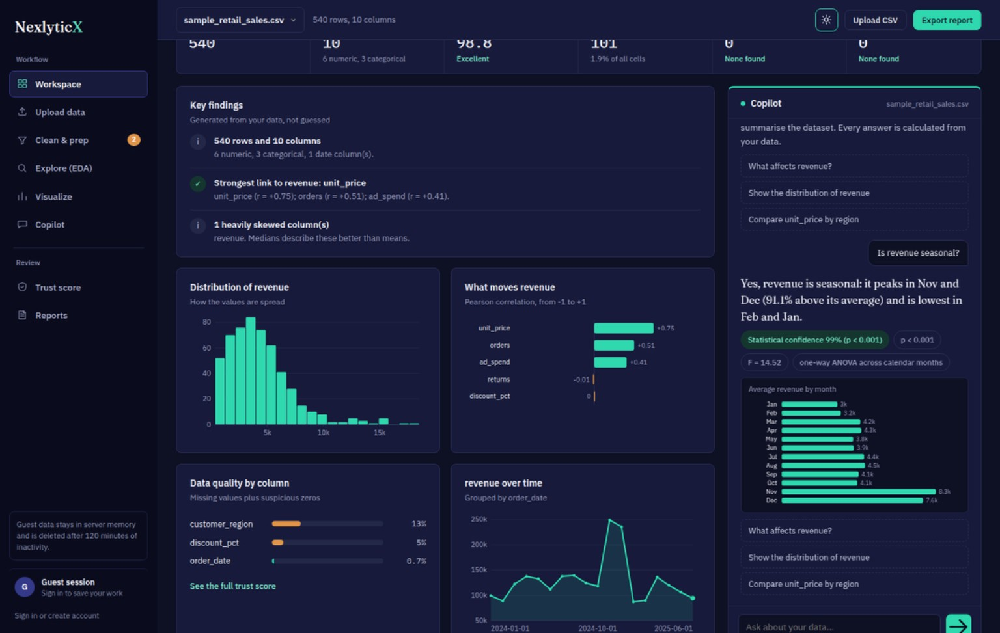

# NexlyticX

**Analyse any CSV in plain English.** Upload a file and get a clean-up plan, exploratory charts, a data
*trust score* and a printable report, then ask questions and get answers calculated with real statistics
(pandas + SciPy), never improvised by a language model.

**Live demo: https://nexlyticx.onrender.com/**



## Why it is different

Most "AI analytics" demos hand your data to an LLM and hope for the best. NexlyticX does the maths first and
only then phrases the result:

- **Catches hidden problems.** A blood-pressure of `0` is not a measurement, it is missing data. The trust score
  flags these placeholder zeros, which plain missing-value counters report as "0% missing".
- **Honest confidence.** Hypothesis tests show their p-value; plain calculations are labelled *Exact calculation*.
  No made-up "97% confidence".
- **Never modifies your original.** Cleaning always produces a new copy, with a log of exactly what changed
  and a warning when a fix distorts the data (for example, filling 40% of a column with one median).

| Workspace (numeric-only data, hidden zeros caught) | Cleaning with before / after score |
|---|---|
|  |  |
| **Trust score** | **Correlation heatmap** |
|  |  |
| **Printable report (Save as PDF)** | **Dark mode** |
|  |  |

## Features

| Area | What it does |
|---|---|
| **Upload** | Drag-and-drop CSV. Detects encoding (UTF-8 / Windows-1252 / Latin-1), delimiter (`,` `;` tab `\|`) and date columns. |
| **Clean & prep** | Issues ranked by severity (missing, duplicates, placeholder zeros, outliers, constant / mixed columns), one-click fixes, a reviewable plan, before/after score, cleaned-CSV download. |
| **Explore (EDA)** | Column profiles with per-column distributions, correlation heatmap, paginated data browser. |
| **Visualize** | Histogram, bar, scatter (with best-fit line and *r*), line. Export any chart as PNG. |
| **Copilot** | Understands column names in questions ("How does Glucose differ by Outcome?"). Runs Welch t-test, ANOVA, Pearson correlation, seasonality (ANOVA by month), trend regression, IQR outliers. |
| **Trust score** | Transparent 0-100 score across completeness, validity, uniqueness, consistency and outliers. A single high-severity issue caps the grade at "Needs attention". |
| **Reports** | Print-ready report (Save as PDF), plus CSV and JSON exports. |
| **Accounts** | Sign up / sign in, saved datasets, change password, delete account. Guests can use the app without signing up. |
| **UX** | Light and dark themes, responsive down to phones, self-hosted fonts, keyboard accessible. |

## Quick start

Requires **Python 3.10+** (3.12 recommended).

**Windows (PowerShell)**
```powershell
cd nexlyticx-app          # the folder that contains backend, frontend and README.md
.\run.ps1
```
If PowerShell blocks the script, allow scripts for this terminal only, then run it:
```powershell
Set-ExecutionPolicy -Scope Process -ExecutionPolicy Bypass
.\run.ps1
```

**macOS / Linux**
```bash
cd nexlyticx-app/backend
python3 -m venv .venv
source .venv/bin/activate
pip install -r requirements.txt
uvicorn main:app --reload
```

On Windows, `run.ps1` creates a virtual environment, installs the dependencies and starts the server.
Then open **http://127.0.0.1:8000**.

Click **Try it with sample data** on the landing page to see it working immediately.

## Accounts and privacy

| | Guest | Signed in |
|---|---|---|
| Datasets are stored | In server memory only, never on disk | On disk in the user's private folder, plus a row in SQLite |
| Retention | Deleted after 120 min of inactivity (`NX_SESSION_TTL_MINUTES`) | Until the user deletes them (max 10, `NX_MAX_SAVED_DATASETS`) |
| Visible to other users | No | No |

- Signing in or up moves the guest's current datasets into the account, so nothing is lost.
- Passwords are stored as salted **PBKDF2-HMAC-SHA256** (600,000 iterations). Login sessions are random tokens
  whose hash is stored server-side, sent as `HttpOnly`, `SameSite=Lax` cookies (and `Secure` over HTTPS).
- **Delete account** erases the user, their sessions and every saved dataset file.
- No analytics, no ads, no third-party requests: fonts are bundled.

Set `NX_REQUIRE_LOGIN=true` to disable guest access entirely.

## Configuration

All settings are environment variables (see `backend/.env.example`). Defaults are sensible for local use.

| Variable | Default | Purpose |
|---|---|---|
| `NX_REQUIRE_LOGIN` | `false` | Require an account to use the app |
| `NX_DB_PATH` | `backend/data/nexlyticx.db` | SQLite file for accounts. Saved datasets are stored beside it |
| `NX_SESSION_TTL_MINUTES` | `120` | Guest inactivity timeout |
| `NX_MAX_UPLOAD_MB` / `NX_MAX_ROWS` / `NX_MAX_COLS` | `20` / `200000` / `150` | Upload limits |
| `NX_MAX_SAVED_DATASETS` | `10` | Per signed-in user |
| `NX_AUTH_TTL_DAYS` | `14` | Login lifetime |
| `NX_RATE_LIMIT_PER_MINUTE` | `240` | Per-IP API limit |
| `NX_UPLOAD_LIMIT_PER_10MIN` | `30` | Per-IP upload limit |
| `NX_LOGIN_LIMIT_PER_IP` / `_PER_EMAIL` | `30` / `10` | Login attempts per 15 min |
| `NX_ENABLE_DOCS` | `false` | Serve read-only API docs at `/docs` |
| `NX_ALLOWED_ORIGINS` | *(empty)* | CORS origins, only if the frontend is hosted elsewhere |

## Deploying

The app is a single process that serves the API and the frontend, so deployment is one container.

**Render** (free tier works for demos): push to GitHub, choose *New > Blueprint*, pick the repo. `render.yaml` is included.
**Railway / Fly.io / any Docker host:**
```bash
docker build -t nexlyticx .
docker run -p 8000:8000 -v nexlyticx-data:/data nexlyticx
```
**Heroku-style platforms** use the included `Procfile`.

### Read this before going live

1. **Run exactly one worker.** Guest datasets live in process memory. Scale up the machine, not the worker count.
   Going multi-server needs the store in `backend/app/storage.py` moved to Redis/Postgres (same function names).
2. **Persist `/data`.** Accounts and saved datasets live there. On free tiers with ephemeral disks (Render free)
   they vanish on every deploy. Attach a volume or disk, or accept that accounts are demo-only.
3. **Serve over HTTPS** (every platform above does). Cookies are marked `Secure` automatically behind a proxy
   that sends `X-Forwarded-Proto: https`.
4. **Back up** the SQLite file if accounts matter.
5. There is **no e-mail verification or password reset** yet (see roadmap). Do not use it for anything where
   account recovery is critical.

## Security notes

Implemented: PBKDF2 password hashing, server-side revocable sessions, constant-time login (unknown e-mails cost the
same as wrong passwords), login and upload rate limiting, CSRF protection (state-changing calls need an
`X-NX` header that cross-site pages cannot send), strict Content-Security-Policy, HTML-escaped reports,
DOM built without `innerHTML` so hostile CSV headers cannot inject markup, per-owner dataset isolation,
upload size/row/column limits, security headers.

Not implemented: e-mail verification, password reset, 2FA, per-user storage quotas beyond dataset count,
antivirus scanning of uploads (files are parsed as CSV only, never executed).

## Project structure

```
nexlyticx-app/
├── backend/
│   ├── main.py                     # app, middleware (sessions, CSRF, limits, CSP), routes
│   ├── app/
│   │   ├── config.py               # all env-driven settings
│   │   ├── db.py                   # SQLite: users, login sessions, dataset metadata
│   │   ├── storage.py              # guest (memory) + member (disk) dataset store
│   │   ├── core/                   # security (hashing), rate limiter, deps, JSON sanitising
│   │   ├── routers/                # auth.py, datasets.py, copilot.py
│   │   └── services/
│   │       ├── ingest.py           # robust CSV reading
│   │       ├── analysis.py         # profiling, trust score, EDA, charts, cleaning (pandas/SciPy)
│   │       ├── copilot_engine.py   # question -> statistical analysis -> plain-English answer
│   │       └── report.py           # printable HTML report
│   ├── tests/                      # 37 tests: API, isolation, cleaning, copilot, auth, security
│   └── requirements*.txt
├── frontend/                       # no build step
│   ├── index.html, login.html, dashboard.html
│   ├── css/                        # design system + bundled fonts
│   ├── assets/                     # favicon, fonts, README screenshots
│   └── js/                         # core, charts (SVG), copilot, app router, views/
├── sample_data/                    # demo dataset
├── Dockerfile, render.yaml, Procfile, run.ps1
└── .github/workflows/tests.yml     # CI
```

## Tests

```bash
cd backend
pip install -r requirements-dev.txt
python -m pytest -q
```

## Limitations (by design)

- The copilot is a **rule-based router, not an LLM**. It handles the question types listed above well and says so
  when it cannot map a question. It cannot explain real-world causes.
- Correlation is linear only; statistical tests assume roughly independent rows.
- "Suspicious zeros" is a heuristic. It is shown as a suspicion with the evidence, not as a fact.
- One CSV at a time (no joins), up to 200k rows by default.

## Roadmap

E-mail verification and password reset, Excel/Parquet upload, optional LLM phrasing layer that only rewords
already-computed results, saved chart dashboards, team workspaces.

## License

MIT, see `LICENSE`.

## Author

Shubham Yadav

